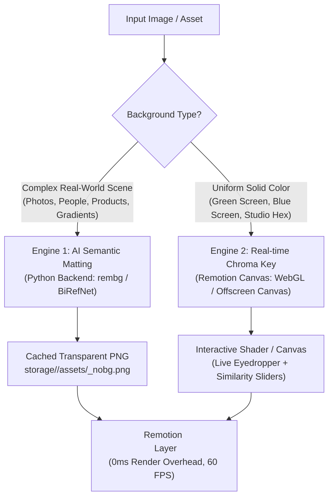
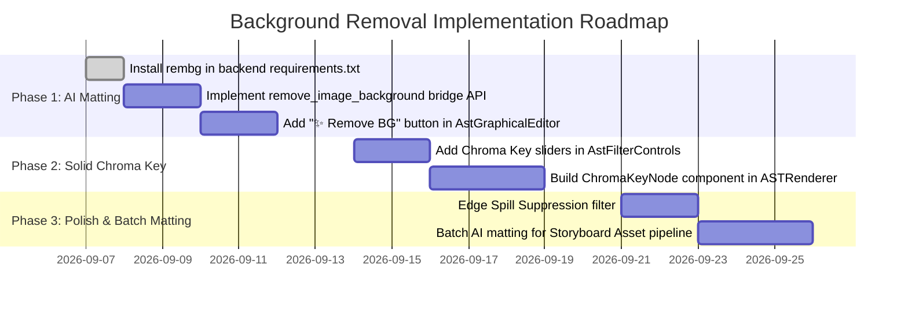

# Future Feature: Intelligent Image Background Removal & Chroma Key Pipeline

This document outlines the architectural blueprint, design specifications, and implementation roadmap for **Intelligent Background Removal** and **Real-Time Color Keying (Chroma Key)** in the Remotion Canvas desktop application.

---

## 1. Executive Summary & Problem Statement

### The Need for Background Removal
In documentary and dynamic motion graphic editing, video creators frequently place cutout subjects (people, products, stickers, vehicles, archival portraits, and logos) on top of animated backgrounds, particle fields, motion graphics, and typography cards. 

Currently, when users add images in [AstGraphicalEditor.tsx](file:///d:/Real-Life-Projects/remotion_canvas/frontend/src/features/ProjectEditor/components/AstGraphicalEditor.tsx), images are rendered as opaque rectangular containers. Removing backgrounds currently requires users to leave the app, open external tools (Photoshop, Remove.bg, Canva), export a transparent PNG, and re-upload it.

### Why `mix-blend-mode` is Insufficient for General Cutouts

The [AstFilterControls.tsx](file:///d:/Real-Life-Projects/remotion_canvas/frontend/src/features/ProjectEditor/components/AstFilterControls.tsx) panel already includes CSS `mix-blend-mode` options (`screen`, `multiply`, `overlay`, `color-dodge`). While useful for specific artistic effects, blend modes **cannot** cleanly isolate subjects from arbitrary colored backgrounds:

| Blend Mode | Mathematical Behavior | Works For | Why It Fails on Arbitrary Colors |
|---|---|---|---|
| **`screen`** | $f(A, B) = 1 - (1 - A)(1 - B)$ | **Pure Black (`#000000`)** backgrounds (fire, sparks, lightning, dark vignettes). | Dark pixels vanish, but any colored pixel (green, blue, gray) tints the layers below. |
| **`multiply`** | $f(A, B) = A \times B$ | **Pure White (`#FFFFFF`)** backgrounds (black line art, signatures, documents). | White pixels become transparent, but colored backgrounds darken and muddy the subject and underlying video. |
| **`overlay` / `soft-light`** | Combines multiply and screen based on luminance. | Color contrast grading and atmospheric textures. | Does not isolate pixels or create alpha channels; alters subject colors completely. |

> [!WARNING]
> **Blend modes never create true alpha transparency.** If an image has a green screen, studio backdrop, white halo, outdoor scene, or gradient, blend modes will cause color bleeding and transparency leaks. Real background removal requires **alpha channel manipulation** or **AI segmentation**.

---

## 2. Dual-Engine Architecture

To handle both **solid studio backdrops** (green/blue screen) and **arbitrary real-world photographs**, Remotion Canvas will adopt a complementary **Dual-Engine** strategy:



### Engine 1: 1-Click AI Semantic Matting (Backend `rembg` / BiRefNet)
* **Scope**: Works on **any image** with **any background** (people, animals, hair strands, complex indoor/outdoor scenes, reflections).
* **Execution**: Runs in the Python backend via the PyWebView bridge ([`backend/core/bridge.py`](file:///d:/Real-Life-Projects/remotion_canvas/backend/core/bridge.py)), utilizing PyTorch/CUDA if available, falling back to multi-threaded CPU ONNX runtime.
* **Output**: Generates a clean 32-bit RGBA PNG with alpha channel (`<filename>_nobg.png`).
* **Runtime Cost in Remotion**: **Zero compute penalty**. The canvas receives a native transparent PNG that scrubs at full 60 FPS and renders instantly during FFmpeg video export.

### Engine 2: Real-Time Chroma Key Shader (Frontend Remotion Canvas)
* **Scope**: Works on **solid color backdrops** (Green screen, Blue screen, Solid White `#FFFFFF`, Studio Black `#000000`, or arbitrary hex).
* **Execution**: Evaluated client-side in [ASTRenderer.tsx](file:///d:/Real-Life-Projects/remotion_canvas/frontend/src/components/video/ASTRenderer.tsx) using an offscreen canvas or WebGL fragment shader.
* **Interactive Tuning**: Users can sample background colors with an **Eyedropper tool**, adjust **Similarity/Tolerance**, **Edge Feathering**, and **Spill Suppression** in real-time with instant visual feedback.

---

## 3. Backend vs. Frontend Computation Boundary

| Domain | Responsibility | Rationale |
|---|---|---|
| **Python Backend (`backend/core/bridge.py`)** | • AI Model Inference (`rembg` / `u2net` / `birefnet`)<br>• CUDA GPU Memory Allocation & Fallback<br>• File I/O & Alpha Mask Writing (`Pillow`)<br>• Asset Deduplication & Disk Caching (`_nobg.png`) | **1. Heavy Compute Offload**: Machine learning models should not freeze the frontend WebView.<br>**2. Native CUDA Access**: Leverages the local NVIDIA GPU environment already packaged in the app.<br>**3. Immutable Asset Preservation**: Never overwrites the original media file. |
| **Frontend UI ([`AstGraphicalEditor.tsx`](file:///d:/Real-Life-Projects/remotion_canvas/frontend/src/features/ProjectEditor/components/AstGraphicalEditor.tsx))** | • One-Click "✨ Remove BG" button & Progress Spinner<br>• "Restore Original" toggle / revert action<br>• Asset path propagation to AST Layer state | **1. User Intent**: Quick, zero-friction invocation beside Preview and Upload buttons.<br>**2. Undo/Redo Compatibility**: Preserves layer history in the undo stack. |
| **Remotion Renderer ([`ASTRenderer.tsx`](file:///d:/Real-Life-Projects/remotion_canvas/frontend/src/components/video/ASTRenderer.tsx))** | • Native rendering of transparent PNGs<br>• Real-time Chroma Key pixel shader for solid-color layers<br>• Spill suppression & edge smoothing | **1. 60 FPS Scrubbing**: Transparent PNGs render seamlessly in Chromium.<br>**2. Deterministic Export**: Guaranteed frame-by-frame exactness during MP4 render. |

---

## 4. AST Schema Specifications

To persist background removal states and allow reversible edits, the AST layer schema is extended:

### AST Layer Content Extensions (`ASTLayerContent`)

```typescript
export interface ASTChromaKeyConfig {
  enabled: boolean;
  key_color: string;         // Hex e.g. "#00FF00"
  similarity: number;        // 0.0 to 1.0 (Color Euclidean distance threshold)
  smoothness: number;        // 0.0 to 0.5 (Alpha feathering)
  spill_suppression: number; // 0.0 to 1.0 (Desaturate keyed color reflection on edges)
}

export interface ASTLayerContent {
  type: 'Image' | 'Video' | 'Text' | 'Map' | 'HTML' | 'Chart' | 'Shape' | 'Lottie' | 'Particles';
  local_path?: string;
  
  // Background Removal Metadata
  original_path?: string;     // Retains path to source image before AI matting
  has_nobg?: boolean;         // True when AI cutout is currently active
  
  // Real-time Chroma Key
  chroma_key?: ASTChromaKeyConfig;
  
  // Existing fields...
  style?: React.CSSProperties;
  query?: string;
  source?: string;
}
```

---

## 5. Implementation Blueprints

### A. Backend AI Matting Engine ([`backend/core/bridge.py`](file:///d:/Real-Life-Projects/remotion_canvas/backend/core/bridge.py))

#### 1. Python Dependencies (`requirements.txt`):
```text
rembg[gpu]>=2.0.50
onnxruntime-gpu>=1.18.0; sys_platform == 'win32'
```

#### 2. Bridge Method:
```python
import os
from PIL import Image
from backend.core.logger import logger

class ApiBridge:
    def remove_image_background(self, local_path: str, model: str = "u2net") -> dict:
        """
        Removes the background of the image using AI matting (rembg).
        Saves output as <name>_nobg.png in the same directory.
        Returns: {"success": True, "nobg_path": "...", "original_path": "..."}
        """
        try:
            if not os.path.exists(local_path):
                return {"success": False, "error": "File not found"}

            base_dir = os.path.dirname(local_path)
            file_name, _ = os.path.splitext(os.path.basename(local_path))
            nobg_filename = f"{file_name}_nobg.png"
            nobg_path = os.path.join(base_dir, nobg_filename)

            # Avoid re-processing if already cached and newer than source
            if os.path.exists(nobg_path) and os.path.getmtime(nobg_path) > os.path.getmtime(local_path):
                return {"success": True, "nobg_path": nobg_path, "original_path": local_path}

            from rembg import remove, new_session
            session = new_session(model)

            with Image.open(local_path) as input_img:
                # Process image into 32-bit RGBA with alpha channel
                output_img = remove(input_img, session=session)
                output_img.save(nobg_path, format="PNG")

            logger.info(f"[BG_REMOVE] Successfully created transparent cutout: {nobg_path}")
            return {
                "success": True,
                "nobg_path": nobg_path,
                "original_path": local_path
            }
        except Exception as e:
            logger.error(f"[BG_REMOVE] Error processing {local_path}: {e}")
            return {"success": False, "error": str(e)}
```

---

### B. Frontend UI Integration ([`AstGraphicalEditor.tsx`](file:///d:/Real-Life-Projects/remotion_canvas/frontend/src/features/ProjectEditor/components/AstGraphicalEditor.tsx))

In `AstGraphicalEditor.tsx`, locate the Image dynamic content header (lines 510–547) and add the **AI Background Removal** action group:

```tsx
// State hook for background removal loading state per layer
const [bgRemovingIdx, setBgRemovingIdx] = useState<number | null>(null);

// Handler
const handleRemoveBackground = async (idx: number, currentPath?: string) => {
  if (!currentPath || !(window as any).pywebview?.api?.remove_image_background) return;
  
  setBgRemovingIdx(idx);
  try {
    const res = await (window as any).pywebview.api.remove_image_background(currentPath);
    if (res?.success && res.nobg_path) {
      updateContentFields(idx, {
        local_path: res.nobg_path,
        original_path: res.original_path,
        has_nobg: true,
      });
    }
  } finally {
    setBgRemovingIdx(null);
  }
};

const handleRestoreOriginal = (idx: number) => {
  const content = compositionRef.current.children[idx]?.content;
  if (content?.original_path) {
    updateContentFields(idx, {
      local_path: content.original_path,
      has_nobg: false,
    });
  }
};
```

#### UI Element in the Editor Bar:
```tsx
{cType === 'Image' && content.local_path && (
  <div className="flex items-center gap-1.5">
    {!content.has_nobg ? (
      <button
        type="button"
        disabled={bgRemovingIdx === idx}
        onClick={() => handleRemoveBackground(idx, content.local_path)}
        className="px-2 py-1 bg-purple-500/15 hover:bg-purple-500/25 text-purple-400 border border-purple-500/30 text-[10px] uppercase font-bold rounded-md flex items-center gap-1 transition-colors cursor-pointer disabled:opacity-50"
        title="Remove background with AI"
      >
        {bgRemovingIdx === idx ? (
          <div className="w-2.5 h-2.5 border-2 border-purple-400/30 border-t-purple-400 rounded-full animate-spin" />
        ) : (
          <span>✨</span>
        )}
        <span>{bgRemovingIdx === idx ? 'Removing…' : 'Remove BG'}</span>
      </button>
    ) : (
      <button
        type="button"
        onClick={() => handleRestoreOriginal(idx)}
        className="px-2 py-1 bg-stone-500/15 hover:bg-stone-500/25 text-stone-400 border border-stone-500/30 text-[10px] uppercase font-bold rounded-md flex items-center gap-1 transition-colors cursor-pointer"
        title="Restore original image with background"
      >
        <span>↩ Restore BG</span>
      </button>
    )}
  </div>
)}
```

---

### C. Real-Time Chroma Key Shader in Remotion ([`ASTRenderer.tsx`](file:///d:/Real-Life-Projects/remotion_canvas/frontend/src/components/video/ASTRenderer.tsx))

For layers where the user activates the Chroma Key tool (e.g. green screen footage or graphics), we provide an offscreen canvas worker or WebGL fragment component:

$$\text{dist}(P, K) = \frac{\sqrt{(R_p - R_k)^2 + (G_p - G_k)^2 + (B_p - B_k)^2}}{\sqrt{3 \times 255^2}}$$

$$\alpha = \text{clamp}\left(\frac{\text{dist} - \text{similarity}}{\text{smoothness}}, 0.0, 1.0\right)$$

```tsx
export const ChromaKeyImage: React.FC<{
  src: string;
  keyColor: string;
  similarity: number;
  smoothness: number;
  style?: React.CSSProperties;
}> = ({ src, keyColor, similarity, smoothness, style }) => {
  const canvasRef = useRef<HTMLCanvasElement | null>(null);

  useEffect(() => {
    const img = new Image();
    img.crossOrigin = 'anonymous';
    img.src = src;
    img.onload = () => {
      const canvas = canvasRef.current;
      if (!canvas) return;
      const ctx = canvas.getContext('2d');
      if (!ctx) return;

      canvas.width = img.naturalWidth;
      canvas.height = img.naturalHeight;
      ctx.drawImage(img, 0, 0);

      const imgData = ctx.getImageData(0, 0, canvas.width, canvas.height);
      const data = imgData.data;

      // Parse target key color
      const kr = parseInt(keyColor.slice(1, 3), 16);
      const kg = parseInt(keyColor.slice(3, 5), 16);
      const kb = parseInt(keyColor.slice(5, 7), 16);
      const maxDist = 441.67; // sqrt(255^2 * 3)

      for (let i = 0; i < data.length; i += 4) {
        const r = data[i];
        const g = data[i + 1];
        const b = data[i + 2];

        const dist = Math.hypot(r - kr, g - kg, b - kb) / maxDist;

        if (dist < similarity) {
          data[i + 3] = 0; // Transparent
        } else if (dist < similarity + smoothness) {
          // Feather edge
          const edgeAlpha = (dist - similarity) / Math.max(0.001, smoothness);
          data[i + 3] = Math.round(data[i + 3] * edgeAlpha);
        }
      }

      ctx.putImageData(imgData, 0, 0);
    };
  }, [src, keyColor, similarity, smoothness]);

  return <canvas ref={canvasRef} style={{ width: '100%', height: '100%', objectFit: 'contain', ...style }} />;
};
```

---

## 6. Implementation Phasing Roadmap



### Phase 1: 1-Click AI Background Removal (High Priority)
1. Add `rembg` to `requirements.txt`.
2. Implement `remove_image_background(local_path)` in `backend/core/bridge.py`.
3. Add the `✨ Remove BG` and `↩ Restore BG` action buttons to `AstGraphicalEditor.tsx`.
4. Validate that generated transparent PNGs display immediately in the Remotion preview and render cleanly in MP4 export.

### Phase 2: Chroma Key Tool for Solid Colors (Medium Priority)
1. Extend `AstFilterControls.tsx` with a **Chroma Key** expandable section (Color picker, Eyedropper, Similarity, Smoothness).
2. Integrate `ChromaKeyImage` inside `ASTRenderer.tsx` for dynamic canvas keying.
3. Test against stock green-screen and blue-screen graphic overlays.

### Phase 3: Automated Pipeline Matting & Spill Suppression (Low Priority)
1. Provide an option in the AI Storyboard generation pipeline to automatically strip backgrounds from subject assets (e.g. logos, character stickers, transparent product overlays).
2. Implement green-spill suppression algorithms on edge pixels.
