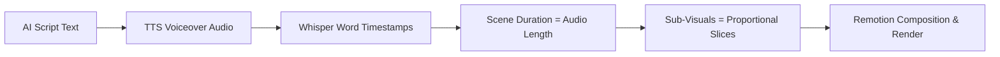
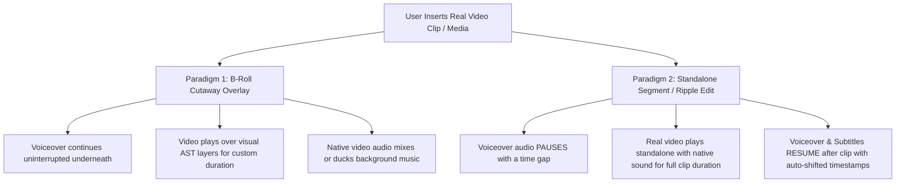

# Future Feature: Next-Gen Hybrid NLE Timeline & Real Video Ingestion Architecture

This document serves as the architectural blueprint, bottleneck analysis, and technical implementation plan for evolving Remotion Canvas from a **Voiceover-Locked AST Engine** into a **Flexible Hybrid Non-Linear Video Editor (NLE)**.

---

## 1. Executive Summary & Problem Statement

### 1.1 The Current System (Voiceover-First / Voiceover-Locked)
In the current architecture, video timeline pacing is strictly determined by speech synthesis (TTS) and Whisper speech-to-text transcriptions:



Under this model:
* **Strict Time Locking**: Every scene's duration is locked to the audio duration of the spoken narration ($\text{Duration}_{\text{Scene}} = \text{Duration}_{\text{Voiceover}}$).
* **Sub-Visual Proportional Slicing**: Sub-visual cuts inside a scene must partition that scene's voiceover duration (`duration_ratio` sum $= 1.0$).
* **Monolithic Global Voiceover**: Audio is played or rendered as a continuous file whose start offset is $0\text{s}$ and end offset is $\sum \text{Scene Durations}$.

---

### 1.2 The Core Architectural Bottlenecks

When producing informative, high-production documentary videos (e.g., Nitish Rajput, Vox, Johnny Harris style), creators frequently need to insert **real, informative external footage**—such as archival news clips, interview snippets, court recordings, product screencasts, or unhurried visual pauses.

The current voiceover-locked architecture imposes severe limitations:

1. **Forced Compression / Truncation of Real Footage**:
   If an AI-generated voiceover sentence is only **2.5 seconds**, any real-world video inserted into that sub-visual slot is forcibly cut at 2.5s or squeezed, even if the footage requires **8–10 seconds** to communicate its informative value.
2. **Inability to Insert Standalone Media Segments (Gaps/Pauses in Narration)**:
   There is no native capability to pause the narrator, play a 10-second historical clip with its **native audio**, and then resume the narration. Users are currently forced to write "filler" script sentences to stretch time.
3. **De-Synchronization of Whisper Transcripts and Kinetic Subtitles**:
   Because subtitle word timestamps are absolute ($T_{\text{start}}, T_{\text{end}}$ from Whisper), inserting independent visual time or silence gaps currently desynchronizes the subtitles from the spoken words for all subsequent scenes.
4. **Lack of Standard NLE In/Out Video Trimming**:
   Users cannot define `trim_start` / `trim_end` points on a 2-minute raw `.mp4` file to select an exact 4-second highlight inside Remotion.
5. **Rigid Single-Track Visual Hierarchy**:
   Everything is bound to `Script -> Scene -> SubVisual`. There is no dedicated multi-track overlay model where B-roll can span across cut boundaries while voiceover continues underneath.

---

## 2. The Two Essential Video Editing Paradigms

To support professional documentary editing alongside AI generation, the engine must support two distinct media insertion paradigms:



### Paradigm 1: B-Roll Cutaway Overlay (Over Continuous Voiceover)
* **Behavior**: The narrator continues speaking, but the visual canvas cuts away to a video clip.
* **Duration**: Bounded by or independent of sub-visual cuts.
* **Audio**: Voiceover remains primary ($100\%$), video native audio is mixed low ($0\text{–}30\%$), and background music automatically ducks.

### Paradigm 2: Standalone Media Segment / Timeline Insertion (Ripple Edit)
* **Behavior**: Narration pauses. The timeline opens up a dedicated media block.
* **Duration**: Determined entirely by the media clip duration or user-defined duration (e.g., $8.5\text{s}$).
* **Audio**: Narration is silent ($0\%$), native clip audio is primary ($100\%$).
* **Ripple Shift**: All subsequent scenes, voiceover audio segments, Whisper transcriptions, and subtitles shift forward by the clip duration ($\Delta t$).

---

## 3. Target Hybrid Architecture & Data Model

```
┌─────────────────────────────────────────────────────────────────────────────────────────┐
│                               HYBRID NLE TIMELINE MODEL                                 │
├─────────────────┬─────────────────────┬───────────────────────────┬─────────────────────┤
│ Layer / Track   │ Scene 1 (AI AST)    │ Media Segment (Raw Clip)  │ Scene 2 (AI AST)    │
├─────────────────┼─────────────────────┼───────────────────────────┼─────────────────────┤
│ B-Roll Overlay  │  [ B-Roll Cutaway ] │                           │                     │
├─────────────────┼─────────────────────┼───────────────────────────┼─────────────────────┤
│ Main Video AST  │ Sub 1.1 │ Sub 1.2   │ [ 8.5s News Archive MP4 ] │ Sub 2.1 │ Sub 2.2   │
├─────────────────┼─────────────────────┼───────────────────────────┼─────────────────────┤
│ Voiceover Audio │ [ TTS Wave: 3.8s ]  │ ──────── SILENCE ──────── │ [ TTS Wave: 4.5s ]  │
├─────────────────┼─────────────────────┼───────────────────────────┼─────────────────────┤
│ Clip Audio      │                     │ [ Native Video Audio ]    │                     │
├─────────────────┼─────────────────────┼───────────────────────────┼─────────────────────┤
│ Dynamic Subs    │ Words @ 0.0s – 3.8s │ (No Subtitles)            │ Words @ 12.3s+      │
└─────────────────┴─────────────────────┴───────────────────────────┴─────────────────────┘
```

### 3.1 Data Schema Extensions (`script.json` / `manifest.json`)

To represent both AI scenes and standalone media clips without schema bifurcation, the `scenes` array is generalized into polymorphic timeline blocks:

#### A. Standard Spoken Scene with Optional Trailing Video Padding
```json
{
  "section_type": "scene",
  "index": 0,
  "title": "Historical Context",
  "narration": "In 1991, the economic reforms changed the landscape forever.",
  "audio_file": "scene_001.wav",
  "audio_duration": 4.2,
  "post_padding_seconds": 2.0,
  "duration": 6.2,
  "sub_visuals": [
    {
      "duration_ratio": 0.5,
      "composition": { "type": "Sequence", "children": [] }
    },
    {
      "duration_ratio": 0.5,
      "composition": {
        "type": "Sequence",
        "children": [
          {
            "content": {
              "type": "Video",
              "local_path": "assets/clips/reform_signing.mp4",
              "trim_start": 12.4,
              "trim_end": 15.5,
              "volume": 0.2,
              "loop": false
            }
          }
        ]
      }
    }
  ]
}
```

#### B. Standalone Media Segment (`media_segment`)
```json
{
  "section_type": "media_segment",
  "index": 1,
  "title": "Prime Minister Speech Archive",
  "has_voiceover": false,
  "duration": 8.5,
  "audio_file": null,
  "media_source": {
    "type": "video",
    "local_path": "assets/user_clips/pm_speech_1991.mp4",
    "trim_start": 4.0,
    "trim_end": 12.5,
    "volume": 1.0,
    "loop": false
  },
  "sub_visuals": []
}
```

---

## 4. Dynamic Timeline Math & Ripple Subtitle Synchronization

### 4.1 Frame Offset Calculation
Instead of relying on a monolithic audio duration, timeline start frames are calculated dynamically:

$$\text{StartFrame}(Scene_k) = \sum_{i=0}^{k-1} \max\left(30, \left\lceil \text{Duration}(Scene_i) \times 30 \right\rceil\right)$$

Where $\text{Duration}(Scene_i)$ accounts for:
1. Pure narration duration ($\text{TTS Duration}$).
2. User-extended scene duration ($\text{TTS Duration} + \text{Padding}$).
3. Standalone media segment duration ($\text{Clip Duration}$).

### 4.2 Dynamic Subtitle Time-Shifting
Whisper transcriptions (`transcription.json`) store segment and word timestamps relative to each audio clip. The subtitle rendering engine (`KineticSubtitles.tsx`) applies cumulative frame offsets at runtime:

```typescript
// Dynamically compute global display window for each word
const globalWordStart = sceneStartFrame + Math.round(word.start * FPS);
const globalWordEnd = sceneStartFrame + Math.round(word.end * FPS);
```

**Result**: Even if a 15-second raw video clip or silence gap is placed in the middle of the timeline, all subsequent subtitles automatically render at their exact voiceover moments without re-running Whisper.

---

## 5. Remotion Composition & Multi-Audio Mixing

### 5.1 Preview Player Architecture (`NitishRajputComposition.tsx`)
In the preview environment, Remotion handles time-gapped voiceover and native video audio:

```tsx
{/* 1. Time-Gapped Voiceover Track */}
{scenes.map((scene, idx) => {
  if (!scene.audio_url || scene.section_type === 'media_segment') return null;
  const fromFrame = sceneOffsets[idx];
  const durationFrames = Math.max(30, Math.ceil(scene.audio_duration * 30));

  return (
    <Sequence key={`audio-${idx}`} from={fromFrame} durationInFrames={durationFrames}>
      <Audio src={scene.audio_url} volume={voiceoverVolume} />
    </Sequence>
  );
})}

{/* 2. Standalone Media Segments & Video Primitives with Trimming */}
<Sequence from={clipStartFrame} durationInFrames={clipDurationFrames}>
  <Video
    src={clipUrl}
    startFrom={Math.round(trimStart * 30)}
    endAt={Math.round(trimEnd * 30)}
    volume={clipVolume}
  />
</Sequence>
```

### 5.2 High-Speed Headless FFmpeg Export (`render.py`)
During production export:
1. Remotion renders the visual stream (including AST animations, video clips, and overlays) to raw video.
2. FFmpeg constructs a multi-source audio filtergraph:
   * Chunks of scene voiceover audio delayed to their exact frame timestamps using `adelay`.
   * Native audio streams extracted from inserted video clips (`-ss` and `-to` trimmed) delayed to their timeline slots.
   * Background music automatically ducked during high-volume voiceover and video speech intervals.
   * Final single-pass audio merge via `amix`.

---

## 6. Frontend Editor Workspace UX/UI Blueprint

```
┌─────────────────────────────────────────────────────────────────────────────┐
│                             TIMELINE UI CONTROLS                            │
├─────────────────────────────────────────────────────────────────────────────┤
│ [ + Add Scene ]  [ + Insert Video Clip ]  [ ✂ Split at Playhead ]  [ Zoom ] │
├─────────────────────────────────────────────────────────────────────────────┤
│ Tracks:                                                                     │
│  [Video]       |─── Scene 1 ───| [ 🎬 News Clip (8s) ] |─── Scene 2 ───|    │
│  [B-Roll]      |               |                       | [ B-Roll ]    |    │
│  [Voiceover]   | ▓▓▓▓▓▓▓▓▓▓▓▓  | ░░░░░░░░░░░░░░░░░░░░  | ▓▓▓▓▓▓▓▓▓▓▓▓  |    │
│  [Clip Audio]  |               | ▓▓▓▓▓▓▓▓▓▓▓▓▓▓▓▓▓▓▓▓  |               |    │
│  [Subtitles]   | ■■ ■■■ ■■■■■  |                       | ■■■ ■■ ■■■■■  |    │
└─────────────────────────────────────────────────────────────────────────────┘
```

### 6.1 Media Insertion Modal
When a user drags a video file onto the timeline or clicks **Insert Video Clip**, they are presented with a choice:
1. **Insert as Standalone Scene (Ripple Edit)**:
   * Splits the timeline at the playhead or scene boundary.
   * Inserts the full video with native sound.
   * Pushes subsequent scenes forward.
2. **Overlay as B-Roll / Sub-Visual**:
   * Attaches to the current scene.
   * Plays over the voiceover without shifting timeline length.

### 6.2 Video Trimmer in Inspector Panel
When any video cut or media segment is selected:
* **Interactive Range Bar**: Left handle (In-Point), Right handle (Out-Point).
* **Mini-Scrubber**: Preview playback of the raw source clip before applying.
* **Audio Controls**: Volume slider, Mute toggle, Audio Ducking priority selector.

---

## 7. Step-by-Step Implementation Roadmap

| Phase | Milestone | Core Deliverables |
| :--- | :--- | :--- |
| **Phase 1** | **Data Model & Media Segment Support** | • Extend `script.json` / `manifest.json` with `media_segment` type.<br>• Update `useEditorData.ts` to compute scene timings from both audio and explicit visual durations. |
| **Phase 2** | **Dynamic Ripple & Subtitle Offset Sync** | • Decouple Whisper word timestamps from absolute global frames.<br>• Map subtitle display windows relative to dynamic scene start offsets in `KineticSubtitles.tsx`. |
| **Phase 3** | **Video In/Out Point Trimming & AST Primitives** | • Add `trim_start` / `trim_end` / `startFrom` support to `<MediaNode>` in `ASTRenderer.tsx`.<br>• Build Video Trimmer UI in the Inspector panel. |
| **Phase 4** | **Timeline UI & Insertion Controls** | • Add "+ Insert Media Clip" action on Timeline ruler and context menu.<br>• Implement drag-to-resize audio trailing gaps / padding handles. |
| **Phase 5** | **FFmpeg Multi-Track Export Engine** | • Update `backend/pipeline/render.py` complex audio filtergraph to mix dynamic scene voiceover delays and native video clip audio streams. |

---

## 8. Summary of Architectural Evolution

| Capability | Legacy Architecture | Next-Gen Hybrid NLE Architecture |
| :--- | :--- | :--- |
| **Pacing Driver** | 100% TTS voiceover length | Hybrid: Voiceover when speaking, Clip length when inserting media |
| **Informative Footage** | Forced into small sub-visual slices | Standalone full-length segments with native sound |
| **Timeline Flexibility** | Locked proportional subdivisions | True NLE: Ripple edits, audio pauses, B-roll overlays |
| **Subtitles** | Breaks on timeline duration edits | Auto-offsetting subtitle engine stays perfectly synchronized |
| **Audio Mixing** | Single global voiceover track | Segmented voiceover + Native clip audio + Dynamic BGM ducking |
