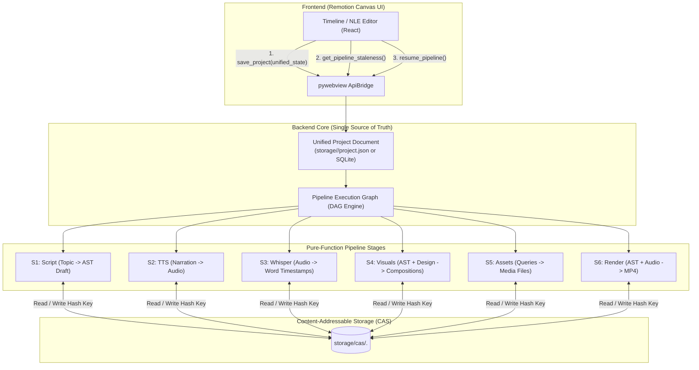

# Future Feature: Next-Gen Content-Addressed Smart Resume & Unified State Architecture

This document outlines the architectural blueprint and implementation plan for the next-generation **Smart Resume Engine** in Remotion Canvas, transitioning from multi-file manifest synchronization to a **Content-Addressed Directed Acyclic Graph (DAG)** and **Unified Canonical State** model.

---

## 1. Executive Summary & Architectural Motivation

### Current System Challenges
* **Multi-File Manifest Divergence**: Project state is distributed across `script.json`, `voiceover/manifest.json`, and `assets/assets_manifest.json`. Editing in one place requires synchronization routines across downstream stages.
* **Redundant Asset Storage**: Identical TTS audio clips, stock video B-roll, and rendered frame elements across projects or repeated runs are stored redundantly on disk.
* **File-System Coupling**: Pipeline steps rely on mutable file paths on disk rather than immutable content fingerprints.

### Next-Gen Goals
1. **Single Source of Truth**: Consolidate narration, word-level timestamps, AST visual layers, and audio parameters into a single canonical document or SQLite record.
2. **Content-Addressable Storage (CAS)**: Store all binary artifacts (audio clips, images, videos, render frames) keyed by their cryptographic SHA-256 hash.
3. **Pure-Function Pipeline Execution**: Model every stage as $O = f(\text{InputHash})$, enabling deterministic, instant cache hits ($0\text{s}$ compute, $0$ LLM tokens, $0$ redundant frame renders).

---

## 2. Backend vs. Frontend Computation Boundary

To guarantee rock-solid cache consistency and 60 FPS interactive editing, computation responsibilities are strictly partitioned:

| Layer | Domain Responsibility | Rationale |
|---|---|---|
| **Backend (Ground Truth & Execution)** | • Canonical Content Hashing (`SHA-256`)<br>• Staleness Graph Invalidation<br>• CAS Deduplication Lookups (`storage/cas/`)<br>• Intra-stage AST Memoization & Duration Rescaling<br>• Multi-domain Frame/Audio Diffing<br>• Asset Garbage Collection | **1. File System Truth**: Direct access to `mtime`, file hashes, GPU cache, and FFmpeg.<br>**2. Headless/CLI Compatibility**: Batch rendering and background workers run without UI active.<br>**3. Eliminates Desync**: Prevents subtle hashing discrepancies between JavaScript and Python engines. |
| **Frontend (UI Projection & Fast Feedback)** | • Optimistic Timeline Editing (0ms latency)<br>• Remotion Canvas real-time preview playback<br>• Visual Stale Badges (*"Voiceover Needs Update"* via API)<br>• Web Audio Waveform Peak Rendering | **1. 60 FPS Interactivity**: Timeline trimming, scrubbing, and cut splitting must remain instantaneous.<br>**2. Zero Business Logic Drift**: Frontend queries `api.get_pipeline_staleness(projectId)` to render status indicators rather than duplicating Python hashing logic. |

---

## 3. High-Level Architecture



---

## 4. Technical Specifications & Schemas

### A. Unified Project Document Schema (`project.json`)
```json
{
  "$schema": "https://json-schema.org/draft/2020-12/schema",
  "id": "131c4e9e-3cdc-42f1-88d7-2d8be7d45a75",
  "meta": {
    "title": "Why Python Is Slow (And Why It Does Not Matter)",
    "format": "landscape",
    "target_duration": 60.0,
    "language": "hi",
    "genre": "documentary"
  },
  "design_system": {
    "theme_name": "Cyberpunk Cyan",
    "color_palette": {
      "primary": "#00f2fe",
      "accent": "#fe0979",
      "background": "#0b0f19"
    },
    "typography": {
      "heading_font": "Oswald",
      "body_font": "Inter"
    }
  },
  "audio_tracks": {
    "bg_music_cas_hash": "e3b0c44298fc1c149afbf4c8996fb92427ae41e4649b934ca495991b7852b855",
    "bg_music_volume": 0.15,
    "voiceover_volume": 1.0
  },
  "scenes": [
    {
      "scene_id": "sc_01",
      "scene_number": 1,
      "title": "Introduction",
      "section_type": "introduction",
      "narration": "Python is shockingly slow, and that is exactly why it runs the world.",
      "duration": 4.68,
      "audio": {
        "cas_hash": "9b71d224bd62f3785d96d46ad3ea3d73319bfbc2890caadae2dff72519673ca7",
        "engine": "edge_tts",
        "voice": "hi-IN-MadhurNeural"
      },
      "transcription": {
        "words": [
          { "word": "Python", "start": 0.1, "end": 0.6, "score": 0.98 },
          { "word": "is", "start": 0.62, "end": 0.75, "score": 0.95 }
        ]
      },
      "sub_visuals": [
        {
          "sub_id": "sv_01_01",
          "duration": 2.34,
          "duration_ratio": 0.5,
          "transition": "glitch",
          "composition": {
            "type": "Sequence",
            "children": [
              {
                "type": "Layer",
                "content": {
                  "type": "Video",
                  "cas_hash": "a591a6d40bf420404a011733cfb7b190d62c65bf0bcda32b57b277d9ad9f146e",
                  "style": { "position": "absolute", "width": "100%", "height": "100%" }
                }
              }
            ]
          }
        }
      ]
    }
  ]
}
```

---

### B. Content-Addressable Storage Engine (`backend/core/cas.py`)
```python
class ContentAddressableStorage:
    def __init__(self, root_dir: Path):
        self.cas_dir = root_dir / "cas"
        self.cas_dir.mkdir(parents=True, exist_ok=True)

    def put_bytes(self, data: bytes, ext: str) -> str:
        """Store bytes and return SHA-256 hash key."""
        hash_key = hashlib.sha256(data).hexdigest()
        target = self.cas_dir / f"{hash_key[:2]}" / f"{hash_key}.{ext.lstrip('.')}"
        target.parent.mkdir(parents=True, exist_ok=True)
        if not target.exists():
            target.write_bytes(data)
        return hash_key

    def get_path(self, hash_key: str, ext: str) -> Optional[Path]:
        """Resolve file path by hash key."""
        target = self.cas_dir / f"{hash_key[:2]}" / f"{hash_key}.{ext.lstrip('.')}"
        return target if target.exists() else None

    def exists(self, hash_key: str, ext: str) -> bool:
        """Check if an artifact is already memoized in CAS."""
        target = self.cas_dir / f"{hash_key[:2]}" / f"{hash_key}.{ext.lstrip('.')}"
        return target.exists()
```

---

### C. Backend Staleness Query API (`get_pipeline_staleness`)
Endpoint called by frontend to inspect pipeline state without triggering computation:
```json
{
  "project_id": "131c4e9e-3cdc-42f1-88d7-2d8be7d45a75",
  "is_fully_cached": false,
  "render_scope": "frames_only",
  "steps": [
    { "name": "generate_script", "is_stale": false, "reason": "Unchanged" },
    { "name": "generate_voiceover", "is_stale": false, "reason": "Narration & Voice matches CAS" },
    { "name": "transcribe", "is_stale": false, "reason": "Word timestamps aligned to CAS audio" },
    { "name": "generate_visuals", "is_stale": false, "reason": "All scene AST compositions valid" },
    { "name": "fetch_assets", "is_stale": false, "reason": "All CAS media artifacts exist on disk" },
    { "name": "render", "is_stale": true, "reason": "Scene 3 visual AST style modified; audio unchanged" }
  ]
}
```

---

## 5. Implementation Roadmap

### Phase 1: Canonical Document & Auto-Migrator
* Build `backend/core/project_model.py` containing unified Pydantic data models for the project document.
* Add an automatic migration layer in `bridge.py` that ingests legacy 3-file projects (`script.json`, `voiceover/manifest.json`, `assets/assets_manifest.json`) and writes out the unified `project.json`.

### Phase 2: CAS Ingestion for Media & Audio
* Deploy `backend/core/cas.py`.
* Update `generate_voiceover_pipeline` to write TTS audio segments directly into CAS.
* Update `fetch_assets_pipeline` to write downloaded Pexels/Pixabay clips and uploaded images into CAS.

### Phase 3: Pure-Function Pipeline Execution & Graph Engine
* Create `backend/pipeline/cache_engine.py` to evaluate inputs against CAS keys.
* Update `QueueManager.queue_project(is_resume=True)` to execute only dirty graph nodes.

### Phase 4: Frontend Contract & Timeline Status Badges
* Wire `usePipeline.ts` to consume `get_pipeline_staleness`.
* Render realtime visual status badges on timeline track headers (e.g., green dot for *Cached*, yellow warning for *Stale - Needs Re-render*).