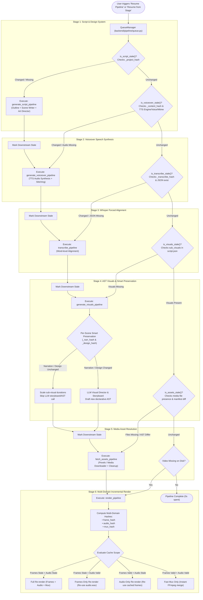
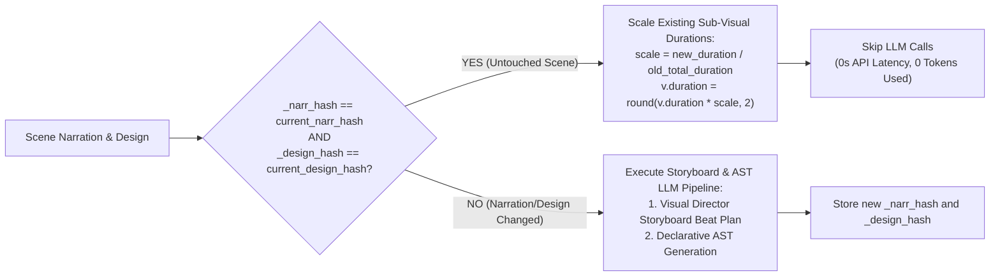
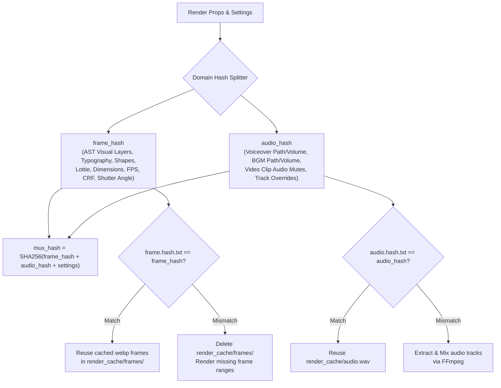
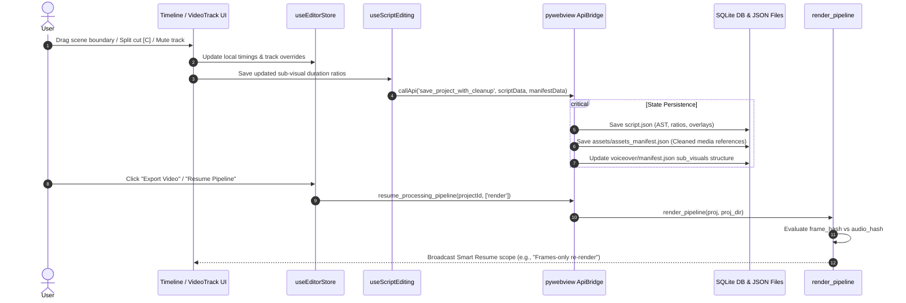

# Smart Resume & Pipeline Caching Architecture

This document provides a comprehensive technical reference for the **Smart Resume** system and **Timeline Synchronization Engine** in Remotion Canvas.

---

## 1. Executive Summary

The video creation pipeline consists of 6 sequential, computationally intensive stages:

```
[1. Script & Design] ──> [2. Voiceover TTS] ──> [3. Transcribe Align] ──> [4. AST Visuals] ──> [5. Asset Ingestion] ──> [6. Final Render]
```

**Smart Resume** is an intelligent incremental computation and caching system designed to:
1. **Prevent Redundant LLM & GPU Work**: If an upstream stage (e.g., narration or TTS voiceover) has not changed, its cached artifacts and manifest are preserved intact.
2. **Support Non-Linear Timeline Editing**: When a user adjusts scene boundaries, splits cuts, tweaks layer styles, or mutes audio tracks, only the minimal downstream sub-range is invalidated and recomputed.
3. **Multi-Domain Render Hashing**: Decouples video frame rendering from audio mixing so changing a background music volume or muting voiceover does not trigger a full visual re-render of hundreds of frames.

---

## 2. High-Level Architecture & Topological Cascade



---

## 3. The 6-Stage Hash Invalidation Matrix

Each pipeline stage defines a deterministic staleness checking function that validates file existence, content hashes, and environmental settings.

| Stage | Checker Function | Source File | Hash / Validation Keys | Trigger Condition for Invalidation |
|---|---|---|---|---|
| **1. `generate_script`** | `is_script_stale()` | [`backend/pipeline/ai.py`](file:///D:/Real-Life-Projects/remotion_canvas/backend/pipeline/ai.py) | `_project_hash` | `script.json` missing, or changes to topic prompt, language, target duration, or format. |
| **2. `generate_voiceover`** | `is_voiceover_stale()` | [`backend/pipeline/tts.py`](file:///D:/Real-Life-Projects/remotion_canvas/backend/pipeline/tts.py) | `_content_hash`, `_voiceover_engine`, `_voiceover_voice`, `_voiceover_voice_mtime` | `voiceover.wav` missing, narration text modified, TTS engine switched, or reference cloning clip replaced. |
| **3. `transcribe`** | `is_transcribe_stale()` | [`backend/pipeline/transcribe.py`](file:///D:/Real-Life-Projects/remotion_canvas/backend/pipeline/transcribe.py) | `_transcribe_hash` (`whisper.hash.txt`) | `subtitles/transcription.json` missing, or Whisper model size/device/language changed in settings. |
| **4. `generate_visuals`** | `is_visuals_stale()` | [`backend/pipeline/assets.py`](file:///D:/Real-Life-Projects/remotion_canvas/backend/pipeline/assets.py) | `sub_visuals` array completeness in `script.json` | Any scene in `script.json` lacks valid `sub_visuals` entries. |
| **5. `fetch_assets`** | `is_assets_stale()` | [`backend/pipeline/assets.py`](file:///D:/Real-Life-Projects/remotion_canvas/backend/pipeline/assets.py) | Stripped AST structure match (`strip_local_paths`) + local file existence | Any referenced image/video file missing on disk, or visual layer types/cues modified in `script.json`. |
| **6. `render`** | `is_render_stale()` / Multi-Domain Hashes | [`backend/pipeline/render.py`](file:///D:/Real-Life-Projects/remotion_canvas/backend/pipeline/render.py) | `frame.hash.txt`, `audio.hash.txt`, `mux.hash.txt` | Target MP4 missing, AST layer style/animation changed, background music tracks/volumes/trims/cuts modified, track volume/mute overridden, or resolution changed. |

---

## 4. Intra-Stage Smart Preservation of Visual ASTs

When `generate_visuals` runs (for instance, after an upstream TTS re-generation due to a minor wording fix in Scene 1), it operates with **per-scene granularity** rather than regenerating all scenes:



### Preservation Rules in Code:
```python
# From backend/pipeline/ai.py
narration_hash = hashlib.md5(narration.encode("utf-8")).hexdigest()[:12]
stored_hash = entry.get("_narr_hash", "")
narration_changed = (stored_hash and stored_hash != narration_hash)

stored_design_hash = entry.get("_design_hash", "")
design_changed = (stored_design_hash and stored_design_hash != current_design_hash)

if not force and existing_sub_visuals and not is_default and not narration_changed and not design_changed:
    # Scale sub-visual durations proportionally to the new audio duration
    old_total = sum([float(v.get("duration", 0)) for v in existing_sub_visuals])
    if old_total > 0:
        scale = duration / old_total
        for v in existing_sub_visuals:
            v["duration"] = round(float(v.get("duration", 0)) * scale, 2)
    entry["_narr_hash"] = narration_hash
    entry["_design_hash"] = current_design_hash
    return entry  # Preserved without calling LLM!
```

---

## 5. Multi-Domain Render Hash Engine

In traditional video renderers, modifying an audio volume or subtitle track forces a full re-render of all video frames. Remotion Canvas solves this by splitting render caching into three discrete domains in [`render.py`](file:///D:/Real-Life-Projects/remotion_canvas/backend/pipeline/render.py):



### The 4 Render Scopes:
1. **`Full re-render`**: Visual layers and audio properties changed. Frames are rendered to WebP, audio is mixed, and both are multiplexed into MP4.
2. **`Frames-only re-render`**: Visual AST changed (e.g. text edit, chart animation), but audio tracks remain identical. Cached `render_cache/audio.wav` is reused immediately.
3. **`Audio-only re-render`**: Visuals untouched, but a track override was toggled (e.g. background music muted). Re-uses 100% of cached `.webp` frames; only FFmpeg audio mix and fast mux execute (~1-2 seconds total).
4. **`Fast mux only`**: Both frame cache and audio cache are 100% valid, but output MP4 was deleted or moved. Instant multiplexing without frame or audio recalculation.

---

## 6. Timeline Editing & State Synchronization

When editing on the interactive Timeline ([`VideoTrack.tsx`](file:///D:/Real-Life-Projects/remotion_canvas/frontend/src/features/EditorWorkspace/components/VideoTrack.tsx), [`Timeline.tsx`](file:///D:/Real-Life-Projects/remotion_canvas/frontend/src/features/EditorWorkspace/Timeline.tsx)), changes are continuously synchronized across both `script.json` and `assets_manifest.json` via [`save_project_with_cleanup`](file:///D:/Real-Life-Projects/remotion_canvas/backend/core/bridge.py):



### Timeline Operations and Their Invalidation Impact:

| User Action on Timeline | Modified Files | Impact on Pipeline Hashes | Resume Invalidation Scope |
|---|---|---|---|
| **Sub-Visual Ratio Resize** | `script.json`, `assets_manifest.json` | `frame_hash` changed; `_content_hash` unchanged. | Stages 1–5 skipped. **Stage 6**: Frames-only re-render. |
| **Scene Boundary Resize** | `script.json`, `assets_manifest.json` | `frame_hash` changed; `_content_hash` unchanged. | Stages 1–5 skipped. **Stage 6**: Frames-only re-render. |
| **Split Cut at Playhead (`C`)** | `script.json`, `assets_manifest.json` | `frame_hash` changed; `_content_hash` unchanged. | Stages 1–5 skipped. **Stage 6**: Frames-only re-render. |
| **Script Narration Edit** | `script.json` | `_content_hash` mismatch; `_narr_hash` mismatch. | **Stages 2–6**: TTS synthesizes new audio; untouched scenes preserved in AST stage. |
| **Track Mute Toggle** | `project_settings` in DB | `audio_hash` mismatch; `frame_hash` unchanged. | Stages 1–5 skipped. **Stage 6**: Audio-only re-render (instant). |
| **Hide Subtitles Toggle** | `project_settings` in DB | `frame_hash` mismatch (subtitle overlay disabled). | Stages 1–5 skipped. **Stage 6**: Frames-only re-render. |

---

## 7. Storage Layout & Artifact Directories

Each project directory in `storage/<project_id>/` maintains dedicated subdirectories and hash descriptors for Smart Resume:

```
storage/<project_id>/
├── script.json                  # Source of truth: chapters, narration, AST compositions
├── design.json                  # Art Director design tokens (colors, typography, CSS)
├── voiceover.wav                # Master stitched narration audio
├── voiceover/
│   ├── manifest.json            # TTS metadata: _content_hash, engine, voice, speeds, clip paths
│   └── scene_0.wav, scene_1.wav # Individual scene audio clips
├── subtitles/
│   ├── transcription.json       # Whisper word-level timing timestamps
│   ├── subtitles.srt            # Standard SubRip captions
│   └── subtitles.vtt            # WebVTT captions
├── assets/
│   ├── assets_manifest.json     # Cleaned visual manifest with active media references
│   └── scene_0_sub_0.jpg        # Downloaded/uploaded image & video assets
└── render_cache/
    ├── frame.hash.txt           # SHA-256 hash of visual AST props & video settings
    ├── audio.hash.txt           # SHA-256 hash of audio sources & track volumes
    ├── mux.hash.txt             # SHA-256 hash of multiplexing parameters
    ├── audio.wav                # Cached mixed audio stream
    └── frames/                  # Cached element-00001.webp ... element-00N.webp frames
```

---

## 8. Best Practices for Extending the Pipeline

When adding new visual layer types, audio effects, or AI generation steps:

1. **Always Implement a Staleness Check**: If adding a new pipeline stage `step_foo`, expose `is_foo_stale(proj, proj_dir) -> bool` in `queue.py`.
2. **Preserve Domain Separation**: Keep visual styling in `frame_hash` and audio properties in `audio_hash`. Do not mix audio properties into the visual frame hash to avoid unnecessary frame invalidations.
3. **Embed Content Hashes in Manifests**: When generating assets or audio, write a `_content_hash` into the stage manifest so future runs can verify change detection without re-reading gigabytes of binary data.
4. **Use Atomic Manifest Updates**: When persisting timeline modifications, update `assets_manifest.json` alongside `script.json` through `save_project_with_cleanup` to prevent manifest divergence.
